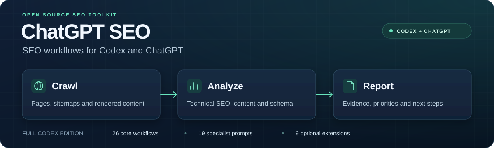

# ChatGPT SEO



[](https://github.com/fox67-w/chatgpt-seo/actions/workflows/package.yml)

**Free, open-source SEO workflows for Codex, adapted from public [Claude SEO](https://github.com/AgriciDaniel/claude-seo).**

Audit websites, investigate technical and content problems, check AI search
readiness, connect authorized SEO data and produce a prioritized plan with
evidence. The full edition includes the local execution runtime, browser support,
specialist prompts and all nine optional provider extensions.

[Quick start](#quick-start) |
[All workflows](#all-26-core-workflows) |
[Specialists](#the-specialist-team) |
[Extensions](#optional-extensions) |
[Reports](#reports-and-evidence) |
[FAQ](#frequently-asked-questions) |
[Documentation](#documentation)

**26 core workflow directories | 19 core specialist prompts | 33 unique
discoverable skills | 9 optional extensions | Python 3.11-3.14**

This repository is an independent Codex adaptation. Its public project name is
**ChatGPT SEO**; the execution package keeps the internal identifier
`codex-seo`. The smaller regular ChatGPT companion retains its **SEO-pro**
identity.

## What it does

- **Technical SEO:** crawlability, indexing signals, robots, redirects, canonical URLs, XML sitemaps, security headers, international SEO and Core Web Vitals.
- **Content and strategy:** E-E-A-T, page quality, search intent, content briefs, keyword clustering, internal linking, comparison pages and programmatic SEO.
- **Structured data and images:** inspect and generate Schema.org markup, validate content alignment, audit alt text and responsive images, and prepare SEO image assets.
- **AI search and agent access:** GEO, citation readiness, AI crawler access, `llms.txt`, Markdown discovery, accessibility and WebMCP checks.
- **Local and commerce:** Google Business Profile signals, citations, reviews, Maps intelligence, product pages and marketplace research.
- **Data and reporting:** authorized Google APIs, backlinks, optional provider data, baseline/change comparisons, Markdown findings and PDF/HTML/Excel reports.
- **Codex execution:** project-scoped skill installation, isolated Python dependencies, Chromium rendering, screenshots and native specialist collaboration.

## Choose your edition

| Edition | Use it in | Execution model |
| --- | --- | --- |
| **Full execution edition** | Codex with local tools | Complete public-source workflows, analysis scripts, managed runtime, browser, specialist prompts and optional integrations. Install from `plugins/codex-seo/`. |
| **SEO-pro companion** | Regular ChatGPT | Project instructions and analysis of supplied text, HTML, drafts or exported reports. Public-page retrieval depends on available host tools; the companion does not install or run this crawler/runtime. |

For regular ChatGPT, start with [companion setup](LOCAL_SETUP.md) and
[Project instructions](chatgpt-project/INSTRUCTIONS.md). Attaching a ZIP to an
ordinary chat does not install the Codex edition.

## Quick start

You need Codex with local command/file tools, Git, Python **3.11-3.14**, network
access for setup and enough disk space for dependencies and Chromium. Select an
existing project where you want the skills available.

### Get the source

```sh
git clone https://github.com/fox67-w/chatgpt-seo.git
cd chatgpt-seo
```

All installation commands below start from this repository root. Replace the
example project path with your own. The first command previews changes; the
second applies them.

### Windows PowerShell

```powershell
$seoProject = "C:\Projects\my-site"
.\plugins\codex-seo\install.ps1 -Project $seoProject -DryRun
.\plugins\codex-seo\install.ps1 -Project $seoProject -Apply

$env:CODEX_SEO_DATA_DIR = Join-Path $seoProject ".runtime\codex-seo"
$seoRunner = Join-Path $seoProject ".agents\packages\codex-seo\scripts\codex-seo.ps1"
& $seoRunner setup
& $seoRunner doctor --json
```

The launcher selects a supported Python executable. If your shell does not allow
PowerShell scripts, the [getting-started guide](docs/GETTING_STARTED.md) includes
a direct Python alternative using the same installer and runtime.

### macOS or Linux

```sh
seo_project="/absolute/path/to/my-site"
bash plugins/codex-seo/install.sh --project "$seo_project" --dry-run
bash plugins/codex-seo/install.sh --project "$seo_project" --apply

export CODEX_SEO_DATA_DIR="$seo_project/.runtime/codex-seo"
seo_runner="$seo_project/.agents/packages/codex-seo/scripts/codex-seo"
bash "$seo_runner" setup
bash "$seo_runner" doctor --json
```

Setup creates an isolated environment and installs Chromium. To prepare only the
HTTP/core runtime, use `setup --skip-browser`; rendering and screenshots then
remain unavailable. Keep the same `CODEX_SEO_DATA_DIR` for later tool commands.
The examples set it for this terminal session rather than changing global settings.

The installer copies the complete resource tree into
`<project>/.agents/packages/codex-seo` and adds discovery bridges under
`<project>/.agents/skills`. All 33 unique workflows are selected by default.
Existing conflicts are preserved and reported. Installation does not connect
provider accounts.

### Run your first audit

Open the target project in Codex and start a chat:

```text
$seo-audit Audit https://example.com. Use the installed codex-seo runtime,
save a report in this project, and identify missing evidence and required accounts.
```

Tell Codex the absolute runtime data directory selected above so its tool commands
reuse that environment. Use `$seo` if you want the hub to choose a workflow.

Native invocations are `$seo` and `$seo-*`. The original `/seo audit ...`
forms remain readable task aliases; they are not registered native slash
commands. If skills do not appear, reopen the project or restart Codex.

### Download instead of cloning

The repository includes a [full edition ZIP](downloads/codex-seo-0.1.0.zip),
[SHA-256 checksum](downloads/codex-seo-0.1.0.sha256) and
[file inventory](downloads/codex-seo-0.1.0.inventory.json). After extracting the
package, run its `install.ps1`, `install.sh` or `install-codex.py` from the
extracted package root, then prepare the installed runtime as above. The archive's
internal name remains `codex-seo`.

## All 26 core workflows

Each row links to the complete skill instructions. Supply a URL, topic, file or
task as appropriate. Provider-dependent workflows state their requirements in
the skill and integration catalog.

| Native invocation | What it covers |
| --- | --- |
| [`$seo`](plugins/codex-seo/skills/seo/SKILL.md) | Hub: choose a workflow, detect business type and coordinate an SEO task. |
| [`$seo-audit <url>`](plugins/codex-seo/skills/seo-audit/SKILL.md) | Full-site audit, specialist findings, evidence coverage and prioritized action plan. |
| [`$seo-page <url>`](plugins/codex-seo/skills/seo-page/SKILL.md) | Detailed analysis of one page rather than a site-wide review. |
| [`$seo-technical <url>`](plugins/codex-seo/skills/seo-technical/SKILL.md) | Technical checks across crawlability, indexability, delivery, rendering and related categories. |
| [`$seo-sitemap <url or task>`](plugins/codex-seo/skills/seo-sitemap/SKILL.md) | Inspect XML sitemaps, find quality/coverage issues or generate a sitemap. |
| [`$seo-schema <url or task>`](plugins/codex-seo/skills/seo-schema/SKILL.md) | Detect and validate structured data; generate markup grounded in verified facts. |
| [`$seo-images <url or task>`](plugins/codex-seo/skills/seo-images/SKILL.md) | Alt text, formats, sizes, responsive images, layout stability, metadata and file optimization. |
| [`$seo-content <url>`](plugins/codex-seo/skills/seo-content/SKILL.md) | Content quality, E-E-A-T, readability, thin content and evidence gaps. |
| [`$seo-content-brief <topic or url>`](plugins/codex-seo/skills/seo-content-brief/SKILL.md) | Target terms, search intent, outline, source requirements and internal-link opportunities. |
| [`$seo-geo <url>`](plugins/codex-seo/skills/seo-geo/SKILL.md) | AI search/citation readiness, crawler access, clarity and authority signals. |
| [`$seo-agentic <task> <url>`](plugins/codex-seo/skills/seo-agentic/SKILL.md) | Agent access, accessibility, Lighthouse Agentic Browsing, `llms.txt`, Markdown and WebMCP. |
| [`$seo-plan <business type>`](plugins/codex-seo/skills/seo-plan/SKILL.md) | SEO strategy for SaaS, local services, ecommerce, publishers and agencies. |
| [`$seo-programmatic <url or plan>`](plugins/codex-seo/skills/seo-programmatic/SKILL.md) | Template/data readiness, scalable page architecture and quality safeguards. |
| [`$seo-competitor-pages <url or task>`](plugins/codex-seo/skills/seo-competitor-pages/SKILL.md) | Competitor comparisons and alternative-page planning/generation. |
| [`$seo-local <url>`](plugins/codex-seo/skills/seo-local/SKILL.md) | Local business signals, NAP consistency, GBP, citations, reviews and local schema. |
| [`$seo-maps <task>`](plugins/codex-seo/skills/seo-maps/SKILL.md) | Geo-grid rankings, GBP review, reviews and nearby competitors; live research needs the relevant provider. |
| [`$seo-hreflang <url or task>`](plugins/codex-seo/skills/seo-hreflang/SKILL.md) | International targeting, hreflang validation and tag generation. |
| [`$seo-google <task>`](plugins/codex-seo/skills/seo-google/SKILL.md) | Search Console, PageSpeed, CrUX, GA4, eligible Indexing API tasks, Google Ads research and reporting. |
| [`$seo-backlinks <url>`](plugins/codex-seo/skills/seo-backlinks/SKILL.md) | Referring domains, anchors, link quality, competitors and gaps using available sources or exports. |
| [`$seo-cluster <seed keyword>`](plugins/codex-seo/skills/seo-cluster/SKILL.md) | SERP-overlap clustering, hub-and-spoke architecture, internal links and content briefs. |
| [`$seo-sxo <url>`](plugins/codex-seo/skills/seo-sxo/SKILL.md) | Search Experience Optimization: intent, page type, user stories, personas and task completion. |
| [`$seo-drift <baseline, compare or history> <url>`](plugins/codex-seo/skills/seo-drift/SKILL.md) | Persist snapshots and investigate SEO changes after deployments or content updates. |
| [`$seo-ecommerce <url>`](plugins/codex-seo/skills/seo-ecommerce/SKILL.md) | Product/category SEO, structured data and marketplace intelligence. |
| [`$seo-dataforseo <task>`](plugins/codex-seo/skills/seo-dataforseo/SKILL.md) | Live SERP, backlink, on-page, business and AI visibility research with authorized DataForSEO tools. |
| [`$seo-image-gen <use case and description>`](plugins/codex-seo/skills/seo-image-gen/SKILL.md) | SEO image assets using available native tools or an explicitly selected Banana/Gemini integration. |
| [`$seo-flow <stage and task>`](plugins/codex-seo/skills/seo-flow/SKILL.md) | FLOW's evidence-led Find, Leverage, Optimize, Win and Local workflows, with retained CC BY 4.0 attribution. |

Runtime `setup` and `doctor` are launcher subcommands, separate from these
26 skill directories. The extension versions of `seo-dataforseo` and
`seo-image-gen` mirror core directories; they do not add duplicate skill names.

## Usage examples

Start with a narrow question when you already know the issue:

```text
$seo-page https://example.com/pricing
$seo-technical https://example.com
$seo-schema Check https://example.com/about and propose only factually supported markup.
$seo-geo https://example.com
$seo-agentic audit https://example.com
$seo-hreflang Audit the language versions linked from https://example.com.
```

For strategy and content:

```text
$seo-plan saas
$seo-content-brief Create a brief for "small business invoicing software".
$seo-cluster Plan a content cluster for "commercial solar installation".
$seo-sxo Review https://example.com/pricing for search intent and task completion.
$seo-flow Find the most important evidence gaps for https://example.com.
```

For changes over time:

```text
$seo-drift baseline https://example.com/pricing
$seo-drift compare https://example.com/pricing
$seo-drift history https://example.com/pricing
```

A baseline is a recorded snapshot, not proof that the page was healthy.
Comparisons require comparable evidence. These commands run when invoked;
recurring execution needs a separately configured schedule.

## How a full audit works

1. **Inspect the site and agree the scope.** Render the homepage where needed,
   identify the business type and discover URLs through links and sitemaps.
   The source audit workflow specifies a default ceiling of 500 pages and
   robots-aware crawling; the report must state actual coverage.
2. **Run the applicable specialist passes.** Technical, content, schema,
   performance, visual, AI search and search experience checks form the base.
   Local, ecommerce, account data and drift passes depend on the site and tools.
3. **Validate findings against evidence.** Keep fetched HTML, browser observations,
   lab measurements, field metrics and provider exports distinct. Failed access
   or missing credentials remain evidence gaps.
4. **Build the action plan.** Group supported findings by severity, show
   dependencies and effort where justified, and give a way to verify each fix.
5. **Save artifacts.** Write findings, coverage, structured data and an action
   plan; generate the requested report formats from the completed data.

The weighted SEO Health Score is an audit rubric, not a Google metric or a
ranking forecast. Unmeasured categories must remain unknown rather than receiving
invented scores. Runtime, site size, account data and the host's model/concurrency
limits determine how long a task takes.

## The specialist team

The package retains 19 core specialist prompt files. Codex reads the applicable
role and dispatches it through native collaboration tools. These files are role
prompts, not automatically registered agent configurations. Model selection
inherits the host settings; no Claude model names or global Claude configuration
are required.

| Specialist | Focus and when it is useful |
| --- | --- |
| [`seo-technical`](plugins/codex-seo/agents/seo-technical.md) | Crawl, indexing, robots, canonicals, redirects, headers and technical delivery. |
| [`seo-content`](plugins/codex-seo/agents/seo-content.md) | Content quality, E-E-A-T, readability and content evidence. |
| [`seo-schema`](plugins/codex-seo/agents/seo-schema.md) | Structured-data detection, validation and recommendations. |
| [`seo-sitemap`](plugins/codex-seo/agents/seo-sitemap.md) | Sitemap structure, URL quality and coverage. |
| [`seo-performance`](plugins/codex-seo/agents/seo-performance.md) | LCP, INP, CLS and performance evidence. |
| [`seo-visual`](plugins/codex-seo/agents/seo-visual.md) | Screenshots, mobile presentation and above-the-fold experience. |
| [`seo-geo`](plugins/codex-seo/agents/seo-geo.md) | AI search access, citation readiness and brand signals. |
| [`seo-agentic`](plugins/codex-seo/agents/seo-agentic.md) | Agent browsing, accessibility, access policy, discovery and WebMCP. |
| [`seo-local`](plugins/codex-seo/agents/seo-local.md) | Local businesses, NAP, GBP, citations and reviews. |
| [`seo-maps`](plugins/codex-seo/agents/seo-maps.md) | Maps/geo-grid and local competitor intelligence when provider tools are available. |
| [`seo-google`](plugins/codex-seo/agents/seo-google.md) | Authorized Google performance, indexing and analytics evidence. |
| [`seo-backlinks`](plugins/codex-seo/agents/seo-backlinks.md) | Available backlink metrics and link-profile investigation. |
| [`seo-dataforseo`](plugins/codex-seo/agents/seo-dataforseo.md) | Live provider enrichment, subject to connection, scope and budget. |
| [`seo-image-gen`](plugins/codex-seo/agents/seo-image-gen.md) | SEO visual assets with an available selected image tool. |
| [`seo-cluster`](plugins/codex-seo/agents/seo-cluster.md) | SERP overlap and content architecture. |
| [`seo-sxo`](plugins/codex-seo/agents/seo-sxo.md) | Search experience, intent and user journeys. |
| [`seo-drift`](plugins/codex-seo/agents/seo-drift.md) | Changes against an existing baseline. |
| [`seo-ecommerce`](plugins/codex-seo/agents/seo-ecommerce.md) | Product markup, commerce pages and marketplace signals. |
| [`seo-flow`](plugins/codex-seo/agents/seo-flow.md) | Selected FLOW strategy stages. |

Extensions retain additional provider-specific context, including Matomo.
Available host concurrency determines batching; a host without delegation can
run the same passes sequentially. A full audit does not launch every role
regardless of relevance or available data.

## Reports and evidence

A full audit workflow saves a directory such as:

```text
example.com-audit/
  FULL-AUDIT-REPORT.md
  ACTION-PLAN.md
  audit-data.json
  findings/
    technical.md
    content.md
    schema.md
    ...
  screenshots/
```

Screenshots require a working browser and accessible pages. Reports may cover a
whole crawl, a sample, one URL or supplied files; their scope must be visible.
The structured envelope supports `null` for unmeasured scores and explicit
coverage/unavailable checks.

| Format | Purpose |
| --- | --- |
| Markdown | Readable audit findings, specialist evidence and implementation plan. |
| JSON | Structured audit data, coverage and machine-readable script results. |
| HTML | Shareable report generated from the completed audit data. |
| PDF | Exportable report with summaries, charts and prioritized findings when the supporting data is present. |
| Excel | Workbook export for reviewing available metrics and findings. |
| Screenshots | Desktop/mobile visual evidence when captured. |

To generate PDF, HTML and Excel from a completed audit envelope, run from the
directory containing the audit folder, keeping the runner variable and runtime
environment from setup.

Windows PowerShell:

```powershell
& $seoRunner run google_report.py --type full --data ./example.com-audit/audit-data.json --domain example.com --output-dir ./example.com-audit --format all --json
```

macOS/Linux:

```sh
bash "$seo_runner" run google_report.py --type full --data ./example.com-audit/audit-data.json --domain example.com --output-dir ./example.com-audit --format all --json
```

Use `--format pdf`, `html`, `xlsx` or `both` for fewer outputs.
PDF generation uses WeasyPrint when its native libraries are available, with a
managed Chromium fallback otherwise. The fallback renders generated report HTML
with JavaScript and external network access disabled.

Reports must distinguish source markup from verified indexing, lab performance
from real-user field data, and citation readiness from observed AI citations.
They must not turn missing data into a clean bill of health, claim an unperformed
site crawl or invent an implementation roadmap.

## Optional extensions

All nine public extension directories are retained. Installing workflows makes
them discoverable; connecting a provider requires the actual tool/account setup.
Basic public-page fetching and local analysis do not require a paid SEO-data
provider.

| Extension and skill | Adds | Account, tool and execution requirements |
| --- | --- | --- |
| [Ahrefs](plugins/codex-seo/extensions/ahrefs/docs/AHREFS-SETUP.md), `$seo-ahrefs` | Ahrefs SEO research through its MCP route. | Authorized Ahrefs API subscription/token (`AHREFS_API_TOKEN`); Node.js/npm for MCP. |
| [DataForSEO](plugins/codex-seo/extensions/dataforseo/docs/DATAFORSEO-SETUP.md), `$seo-dataforseo` | SERPs, backlinks, on-page, business, commerce and AI visibility data. | Funded account, `DATAFORSEO_USERNAME` and `DATAFORSEO_PASSWORD`; Node.js/npm for MCP; authorize paid scope and budget. |
| [Firecrawl](plugins/codex-seo/extensions/firecrawl/docs/FIRECRAWL-SETUP.md), `$seo-firecrawl` | Provider-backed site mapping and crawling. | `FIRECRAWL_API_KEY`, applicable crawl allowance and Node.js/npm for MCP. |
| [Banana](plugins/codex-seo/extensions/banana/docs/BANANA-SETUP.md), `$seo-image-gen` | SEO asset generation/editing with Banana/Gemini. | Authorized `GOOGLE_AI_API_KEY`, selected model and paid scope/budget; MCP needs Node.js/npm, direct API helpers are also retained. |
| [Bing Webmaster](plugins/codex-seo/extensions/bing-webmaster/docs/BING-WEBMASTER-SETUP.md), `$seo-bing` | Bing Webmaster data and IndexNow submissions. | Authorized property and `BING_WEBMASTER_API_KEY`; IndexNow needs its key/setup; URL submission needs explicit authorization. |
| [Matomo](plugins/codex-seo/extensions/matomo/docs/MATOMO-SETUP.md), `$seo-matomo` | Organic analytics, landing pages, device/country and referrer reports. | Authorized instance, `MATOMO_URL` and `MATOMO_API_TOKEN`; private-network instances require an exact-host allowlist. |
| [Profound](plugins/codex-seo/extensions/profound/docs/PROFOUND-SETUP.md), `$seo-profound` | AI citation and visibility research over time. | Independently authorized provider tool or supplied export and a plan with the needed metrics. No standalone client/MCP endpoint is bundled. |
| [SE Ranking](plugins/codex-seo/extensions/seranking/docs/SERANKING-SETUP.md), `$seo-seranking` | AI share-of-voice and visibility research. | Independently authorized provider tool or supplied export and a suitable account plan. No standalone client/MCP endpoint is bundled. |
| [Unlighthouse](plugins/codex-seo/extensions/unlighthouse/docs/UNLIGHTHOUSE-SETUP.md), `$seo-unlighthouse` | Local multi-page Lighthouse runs. | Node.js, a compatible local Unlighthouse CLI and a supported browser; no provider key is required. |

The setup references above retain source-specific background. For Codex
activation and paths, use the [Codex guide](plugins/codex-seo/docs/CODEX.md)
and [machine-readable integration catalog](plugins/codex-seo/extensions/codex-integrations.json).

From this repository root, inspect an integration without connecting an account:

```sh
python plugins/codex-seo/extensions/codex-extension.py list
python plugins/codex-seo/extensions/codex-extension.py plan firecrawl
python plugins/codex-seo/extensions/codex-extension.py toml firecrawl
```

Replace `python` with your supported interpreter command if needed. The
`toml` action prints a Codex MCP configuration fragment containing environment
variable names rather than secret values. It applies only to catalog entries
with bundled MCP configurations. Review the fragment in the intended Codex
configuration and authorize the provider separately. These commands do not
install Node packages, change settings, verify account access or call providers.

### Google APIs and other evidence sources

The core `$seo-google` workflow retains Search Console, URL Inspection,
PageSpeed Insights, CrUX/history, GA4, eligible Indexing API operations, Google
Ads keyword research and supporting Google research tools. Access differs by
API: an API key alone does not authorize private Search Console/GA4 properties.
Google Ads needs the appropriate developer/account credentials. Enable the
required API and check account permissions and quotas.

Use [Google authentication instructions](plugins/codex-seo/skills/seo-google/references/auth-setup.md)
for the selected task. Indexing submissions are limited by Google's eligibility
rules and require explicit authorization; they are not a general indexing
shortcut. Backlink analysis can use available Common Crawl, Moz, Bing or provider
data/exports; this project does not supply its own universal backlink database.

## Advanced installation and runtime

### Runtime controls

| Variable | Purpose |
| --- | --- |
| `CODEX_SEO_DATA_DIR` | Choose the managed runtime/state directory before setup and execution. |
| `CODEX_SEO_CONFIG_DIR` | Override the Codex SEO configuration/credential-store directory. |
| `CODEX_SEO_CACHE_DIR` | Override the cache location, including applicable stored analysis data. |
| `CODEX_SEO_PYTHON` | Select a specific supported executable for shell launchers; it must be Python 3.11-3.14. |
| `CODEX_SEO_LOCAL_TARGETS` | Opt in exact approved local hosts for supported HTTP routes; browser navigation to local targets remains blocked by the inherited URL policy. |

Run bundled analysis scripts through the managed entrypoint so it selects the
isolated dependencies and browser cache. For example, in the terminal session
used during setup:

```powershell
& $seoRunner run fetch_page.py https://example.com
& $seoRunner run render_page.py https://example.com --mode auto --json
```

On macOS/Linux, replace `& $seoRunner` with `bash "$seo_runner"`.
`doctor --json` diagnoses readiness without installing dependencies. Core and
browser readiness are separate. Store provider tokens outside tracked files and
reports; keep runtime state, private exports and client reports out of published
archives.

### Optional native plugin discovery

The project skill installer is the documented independent installation route.
For a host that supports the supplied local marketplace format, the repository
also includes [`marketplace.json.example`](marketplace.json.example).
Copy it to this repository's `.agents/plugins/marketplace.json`, restart Codex
and select the local marketplace. Native host installation remains a distinct,
locally unverified path; copying the catalog does not prepare the Python/browser
runtime or connect any account.

### Optional schema hook

Manual schema tools remain available. Automatic hooks are disabled in the
manifests. The [Codex hook example](plugins/codex-seo/hooks/codex-hooks.example.json)
and [schema event adapter](plugins/codex-seo/hooks/codex-schema-check.py) provide an
opt-in post-edit review route. Review its command/runtime, enable the intended
definition and complete host trust review before using it. A post-edit hook
reports findings; it cannot undo an edit. See the
[full guide](plugins/codex-seo/docs/CODEX.md#schema-validation-hook).

### Remove installed discovery bridges

From the repository root, preview and then apply removal:

```powershell
.\plugins\codex-seo\uninstall.ps1 -Project $seoProject -DryRun
.\plugins\codex-seo\uninstall.ps1 -Project $seoProject -Apply
```

Or on macOS/Linux:

```sh
bash plugins/codex-seo/uninstall.sh --project "$seo_project" --dry-run
bash plugins/codex-seo/uninstall.sh --project "$seo_project" --apply
```

Removal deletes only tracked, unchanged installer-owned discovery bridges.
The copied package, credentials and runtime data are retained; remove those
separately only when you intend to discard them.

## Source coverage and verification

This port retains all **505 original public-source paths** from Claude SEO
**2.6.0**, pinned to
[`cca7e4a267991aca880efade1fd12e8498caf2ce`](https://github.com/AgriciDaniel/claude-seo/tree/cca7e4a267991aca880efade1fd12e8498caf2ce):
26 core skill directories, 19 core specialist prompts, 63 original Python files,
templates, schemas, data and all nine extension directories. The 35 source skill
folders yield 33 unique discoverable skill names because two are mirrors.
All 45 retained FLOW reference/lock files preserve their original Git hashes.

The adaptation changes host integration: package resolution, runtime environment
names, native skill discovery, tool selection and specialist delegation. It
does not depend on Claude host variables, tool names, model aliases or global
Claude settings. It uses only public source, not private/pro-only features.

| Verification state | Recorded result |
| --- | --- |
| Source/workflow/resource coverage | All imported paths accounted for; 35 skill metadata checks and retained FLOW checks passed. |
| Codex regression suite | 2,324 passed, 29 skipped; 387 subtests passed. |
| Old host contracts | 78 exact Claude-only cases have reviewed native Codex equivalents; original analysis/fetch/parser/schema/quota/measurement checks were not waived. |
| Companion/shared suite | 155 run, 2 platform skips, no failures. |
| Local runtime/browser smoke | 10/10 checks passed, including fetching, sitemap discovery, JS execution/rendering, drift and HTML/Excel/PDF generation; public screenshots also passed. |
| Live account/provider tests | Not connected or verified with live paid-provider accounts. |
| Native plugin installation | Not verified in the user's host app. |
| macOS/Linux execution | Not verified locally; Ubuntu/Windows CI is configured. |

These are the recorded local results, not a claim about a hosted CI run.
See [Actions](https://github.com/fox67-w/chatgpt-seo/actions) for hosted status.
Source inclusion, local tests, authenticated-provider execution and installed-host
testing are distinct states. Matching source coverage does not establish
identical model judgments, improved rankings or identical audit results.

Read the [verification record](docs/CODEX_VERIFICATION.md),
[provenance](plugins/codex-seo/CODEX_PROVENANCE.json) and
[per-file source inventory](docs/claude-source-inventory.json) for details.

## Frequently asked questions

### Is it free?

The source code is free to use under its licenses and has no repository-imposed
per-site charge. Codex/ChatGPT access, host usage limits and third-party APIs
have their own plans, quotas and charges. Optional paid services are not included
with this repository.

### Does it include all Claude SEO features?

It retains the full feature/source scope of the pinned **public** revision,
including all optional extension workflows. Some features need a browser,
authorized Google/provider tools, external data or local CLI prerequisites.
Profound and SE Ranking do not gain API clients simply by being copied. Source
coverage is not proof that every account-dependent route has been tested live.
Later upstream changes and private features are outside the pinned revision.

### Can I run the full version in ordinary ChatGPT?

Use Codex for the complete local execution edition described here. Regular
ChatGPT can use the [SEO-pro companion](LOCAL_SETUP.md) for its narrower
instruction/export-analysis workflow and whatever host tools are available.
A GitHub repository or uploaded archive alone does not enable local scripts.

### Do I need API keys to begin?

Public HTTP fetching, local parsing and browser rendering do not need a paid
SEO-provider key. Private Google metrics and provider-specific research do need
their authorized connection. Without those sources, reports must mark indexing,
field CWV, ranking or citation data as unknown when they cannot be verified.

### Does it handle React, Next.js, Vue and other JavaScript sites?

The managed Playwright renderer can inspect JavaScript-rendered pages after
Chromium setup. Authentication, bot challenges, geolocation, delayed interaction
or blocked resources can still limit coverage. Compare fetched and rendered
evidence rather than assuming every page rendered completely.

### Is all analysis local?

Scripts, caches and report files run or reside locally. Content used by Codex is
processed through the configured host/model service. Audited sites, public
research sources and authorized APIs receive applicable requests. Connected
providers may process the data sent to them. This is not an offline-only or
no-data-leaves-the-machine promise.

### Will it improve rankings or guarantee AI citations?

No ranking or citation outcome is guaranteed. The workflows identify evidence,
risks and opportunities and propose verifiable changes. Search engines, site
implementation, competition and model behavior remain outside the tool's control.

### Can it monitor sites automatically?

Drift baselines, comparisons and history are included. Recurring unattended runs
require a separately configured scheduler, execution environment and authorized
provider access. Installing the skills alone does not create scheduled jobs.

### Will it replace a large crawler or SEO database?

It combines inspection, scripts, research and explanation. Crawl depth and
throughput depend on the runtime and workflow, and there is no bundled proprietary
backlink/rank database. Use exports or authorized services when a task needs
their data.

## Troubleshooting

| Symptom | What to check |
| --- | --- |
| Skills are missing | Confirm you opened the selected target project, check the install plan for conflicts, then reopen the project/restart Codex. |
| Unsupported or missing Python | Install 3.11-3.14 or set `CODEX_SEO_PYTHON` to its absolute executable path; do not point it to an unsupported interpreter. |
| Setup is required after an earlier setup | Confirm the same `CODEX_SEO_DATA_DIR` is set and run the installed launcher, then inspect `doctor --json`. |
| Rendering/screenshots fail | Check browser readiness separately from the core runtime; a `--skip-browser` setup does not include Chromium. |
| Local/private URL is rejected | Preserve the URL guard. Approved raw-HTTP local hosts need the exact-host opt-in; browser navigation to local targets remains blocked. |
| A metric is absent | Check API permissions, property/site identifiers, quotas and the data source's availability. Do not infer a passing result. |
| Profound/SE Ranking cannot execute | Supply an independently available authorized provider tool or export; no standalone client is bundled. |
| PDF generation fails | Check native WeasyPrint support or managed Chromium readiness; use HTML/Excel output while resolving the PDF runtime. |
| No parallel specialists appear | Check host collaboration availability and concurrency. Sequential specialist passes remain possible. |
| Windows script policy blocks launchers | Use the direct Python commands in [Getting started](docs/GETTING_STARTED.md); the wrapper is optional. |

Use the [Codex guide](plugins/codex-seo/docs/CODEX.md) and
[execution contract](plugins/codex-seo/skills/seo/references/codex-runtime.md)
for host-specific behavior. Archived upstream documentation can explain the
original workflows but may contain original-host installation examples.

## Documentation

| Guide | Contents |
| --- | --- |
| [Getting started](docs/GETTING_STARTED.md) | Full setup, both platform command sequences, direct Python fallback and first audit. |
| [Codex execution guide](plugins/codex-seo/docs/CODEX.md) | Installation, extensions, managed runtime, hooks and verification. |
| [Execution contract](plugins/codex-seo/skills/seo/references/codex-runtime.md) | Package resolution, tools, collaboration, evidence handling and account authorization. |
| [Audit workflow](plugins/codex-seo/skills/seo-audit/SKILL.md) | Crawl defaults, audit envelope, scoring weights and artifacts. |
| [Integration catalog](plugins/codex-seo/extensions/codex-integrations.json) | Every optional provider's mechanism, environment names and prerequisites. |
| [Verification record](docs/CODEX_VERIFICATION.md) | Completed checks, test translations and practical limits. |
| [Source provenance](plugins/codex-seo/CODEX_PROVENANCE.json) | Exact public upstream revision and port details. |
| [Source inventory](docs/claude-source-inventory.json) | Imported paths and original Git hashes. |
| [ChatGPT companion setup](LOCAL_SETUP.md) | Regular ChatGPT Project instructions and narrower execution contract. |
| [Contributing](CONTRIBUTING.md) | Development setup, regressions, packaging and source-preservation rules. |
| [Support](SUPPORT.md) and [Security](SECURITY.md) | Issue guidance and security reporting. |
| [Full-edition privacy](plugins/codex-seo/PRIVACY.md) and [security](plugins/codex-seo/SECURITY.md) | Current Codex data flows, credential handling and execution boundaries. |

Additional references include the [command reference](plugins/codex-seo/docs/COMMANDS.md),
[architecture](plugins/codex-seo/docs/ARCHITECTURE.md) and
[methodology](plugins/codex-seo/skills/seo/references/thinking-framework.md).
Original-host [troubleshooting](plugins/codex-seo/docs/TROUBLESHOOTING.md) is
retained for reference; follow the Codex guides for this port. The full edition's
[privacy policy](plugins/codex-seo/PRIVACY.md) and
[security policy](plugins/codex-seo/SECURITY.md) describe its current behavior.

## Build and contribute

Use a supported Python executable in an isolated development environment.
From the repository root:

```sh
python -m pip install -r plugins/codex-seo/requirements.txt -r plugins/codex-seo/requirements-dev.txt
python tools/port_codex_workflows.py --check
python tools/codex_port.py --generate
python tools/run_codex_regressions.py
python tools/codex_port.py --build
```

Replace `python` with your installed supported command when necessary. Build
archives, checksums and inventories are written under `dist/codex/`.
The companion/shared checks remain separate; see
[Contributing](CONTRIBUTING.md) for both suites and reproducible companion
packaging. Preserve unrelated edits, original notices and source provenance.
Keep runtime state, credentials and private client data out of commits.

## Attribution and licenses

Original Claude SEO and SEO-pro work by **Daniel Agrici** and the public project
contributors. This independent adaptation preserves the
[MIT license](LICENSE), [project notices](NOTICE.md) and
[full-edition notices](plugins/codex-seo/NOTICE.md), including FLOW's **CC BY 4.0**
attribution and separate font/asset licenses. The full package also retains its
[original license](plugins/codex-seo/LICENSE) and
[contributors](plugins/codex-seo/CONTRIBUTORS.md).

The [original Claude SEO README](plugins/codex-seo/docs/UPSTREAM_README.md) and
[original companion README](docs/UPSTREAM_CHATGPT_README.md) remain available for
attribution and historical context. This project is not endorsed by OpenAI or
Anthropic.
